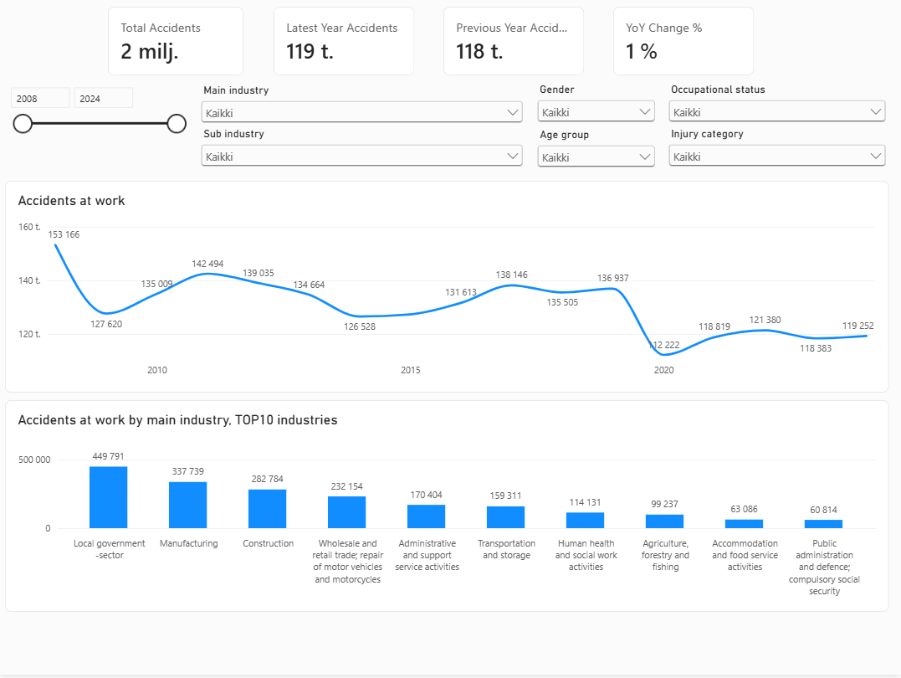

# Occupational Accidents in Finland

An end-to-end data analytics project analysing occupational accidents
in Finland using open data from Statistics Finland.

The project demonstrates data extraction, transformation, modelling,
analysis and visualisation using Python, Databricks, SQL,
Power BI and Git.

## Project Overview

The objective of this project is to analyse occupational accident
statistics in Finland and demonstrate an end-to-end analytics workflow.

The data is retrieved programmatically from Statistics Finland's
StatFin PXWeb API and processed in Databricks using a medallion
architecture consisting of Bronze, Silver and Gold data layers.

The final analytics-ready dataset is used to create an interactive
Power BI report.

The dataset includes occupational accident statistics by:

- Year
- Occupational status
- Injury category
- Industry
- Age group
- Gender

## Dashboard Preview



## Architecture

The project follows the following data flow:

StatFin PXWeb API  
↓  
Python API ingestion  
↓  
Databricks  
↓  
Bronze layer  
↓  
Silver layer  
↓  
Gold layer  
↓  
Power BI

Git and GitHub are used for version control and project documentation.

## Technologies

The project uses:

- Python
- Requests
- Pandas
- PySpark
- Databricks
- Delta Lake
- SQL
- Power BI
- Git
- GitHub
- Visual Studio Code

## Data Source

The data is retrieved from Statistics Finland's StatFin database
through the PXWeb API.

StatFin table:

`ttap/129s`

The project currently retrieves data for:

- 2020
- 2021
- 2022
- 2023
- 2024

API requests are batched by year to keep individual requests
manageable.

## Data Pipeline

### Bronze Layer

The Bronze layer contains the raw data retrieved from the
StatFin PXWeb API.

The purpose of this layer is to preserve the source data before
business transformations are applied.

### Silver Layer

The Silver layer contains cleaned and standardised data.

Transformations include:

- Renaming technical StatFin fields
- Converting columns to appropriate data types
- Creating industry codes
- Creating industry names
- Classifying industry hierarchy levels
- Performing data quality checks

The industry dimension contains both main industries and detailed
industries.

For example:

- `C` = Manufacturing
- `10` = Manufacture of food products
- `11` = Manufacture of beverages

To distinguish these levels, an `industry_level` variable is created.

Possible industry levels include:

- Main industry
- Detailed industry
- Special category
- Unknown

This prevents main and detailed industry categories from being
incorrectly aggregated together.

### Gold Layer

The Gold layer contains analytics-ready data for reporting and
analysis.

The main reporting table is:

`gold_occupational_accidents`

It contains fields such as:

- year
- occupational_status
- injury_category
- industry_code
- industry_name
- industry_level
- age_group
- gender
- accidents

The Gold layer is used as the data source for the Power BI report.

## Power BI Report

The Power BI report provides interactive analysis of occupational
accidents.

The report includes analysis of:

- Accident trends over time
- Occupational accidents by industry
- Detailed industry comparisons
- Age group distributions
- Gender distributions
- Injury categories
- Occupational status

The report also contains KPI cards displaying measures such as:

- Total accidents
- Latest-year accidents
- Previous-year accidents
- Year-on-year change

Custom tooltip pages provide additional information when exploring
industries.

## Data Modelling Considerations

Special attention is given to avoiding double counting.

The StatFin dataset contains both main and detailed industry
classifications.

For example, Manufacturing is represented both as the main industry
`C` and through detailed industries such as `10`, `11`, `12`, etc.

These levels therefore should not be summed together when calculating
overall accident counts.

The Power BI measures use selected industry levels to ensure
consistent aggregation.

The aggregate injury category `At least 4 days` is excluded from
overall accident calculations because detailed injury categories
are used instead.

## Repository Structure

```text
occupational-accidents-finland/
│
├── notebooks/
│   └── Databricks notebooks
│
├── src/
│   └── statfin_api.py
│
├── sql/
│   └── gold_tables.sql
│
├── powerbi/
│   ├── README.md
│   └── screenshots/
│
├── docs/
│   └── data_dictionary.md
│
├── .gitignore
├── requirements.txt
└── README.md